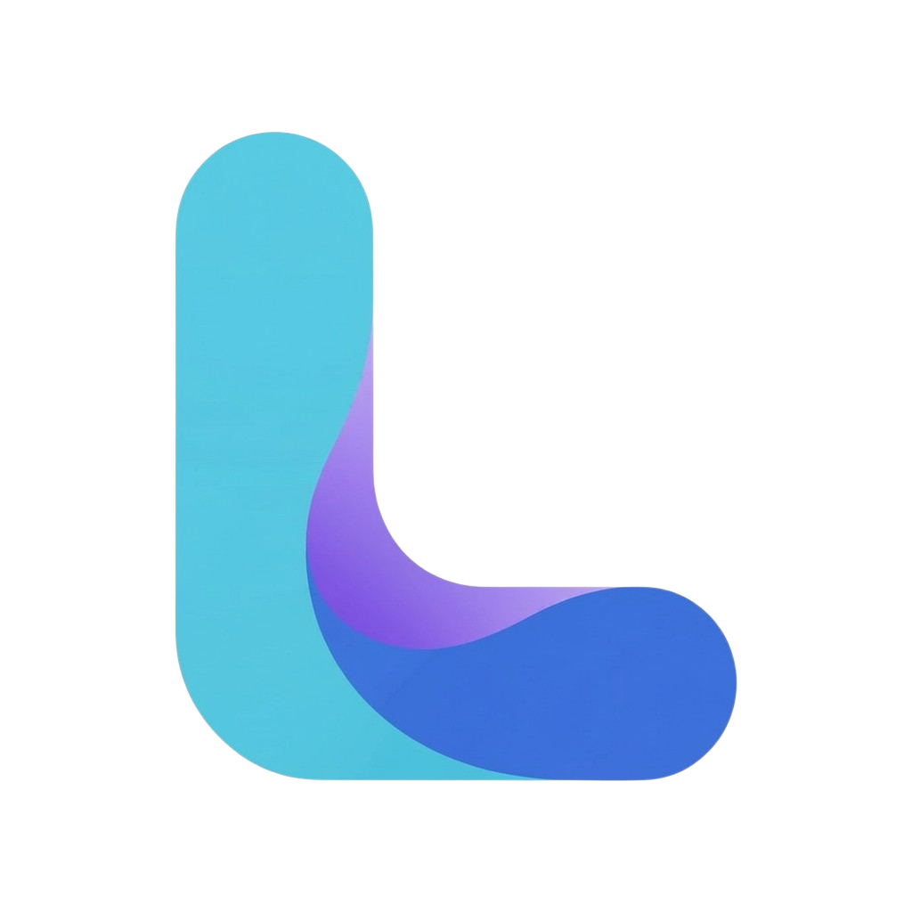
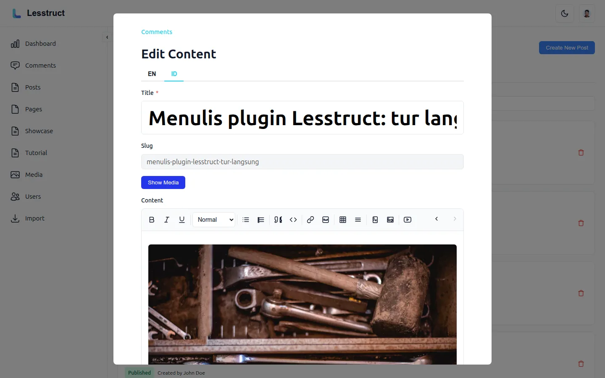
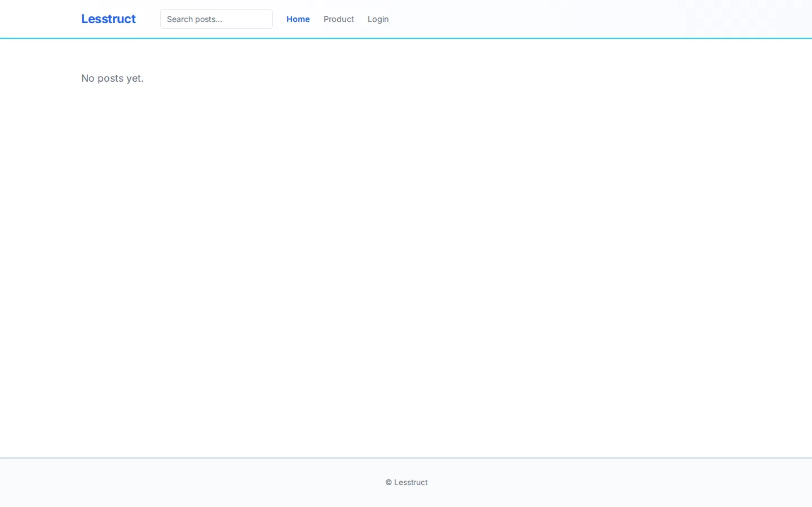
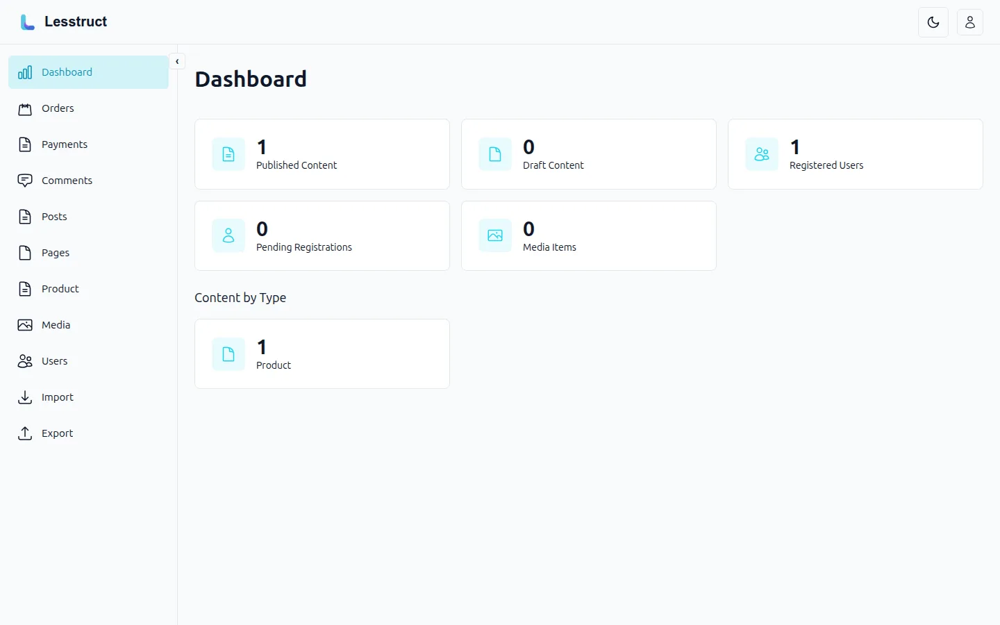

<p align="center">
  
</p>

# Lesstruct

> **Everything is a module.** The Go CMS you can shrink, extend, and ship as one binary — for humans and AI agents.

[](https://go.dev/)
[](#license)
[](https://github.com/aristorinjuang/lesstruct/releases/latest)
[](https://github.com/aristorinjuang/lesstruct/actions)
[](https://lesstruct.dev/)

<table>
  <tr>
    <td width="33.3%" align="center">
      <a href="https://lesstruct.dev/tour/">
        <picture>
          <source media="(prefers-color-scheme: dark)" srcset="docs/assets/screenshots/admin-hero-dark.webp">
          
        </picture>
      </a>
      <br><sub>Admin panel</sub>
    </td>
    <td width="33.3%" align="center">
      <a href="https://lesstruct.dev/tour/">
        
      </a>
      <br><sub>Content site</sub>
    </td>
    <td width="33.3%" align="center">
      <a href="https://lesstruct.dev/docs/features/">
        <picture>
          <source media="(prefers-color-scheme: dark)" srcset="docs/assets/screenshots/dashboard-dark.webp">
          
        </picture>
      </a>
      <br><sub>Dashboard</sub>
    </td>
  </tr>
</table>

## Why Lesstruct?

- **One binary, no Docker.** A single static Go binary runs the whole CMS. SQLite is built in. No runtime, no container, no `node_modules` in production.
- **Everything is a module.** Eleven built-in features are independent modules with a declared dependency graph — disable what you don't need with `[modules] disabled` and dependents cascade. Per-module reference: [`docs/built-in-modules.md`](docs/built-in-modules.md).
- **Multi-database, your choice.** SQLite by default; PostgreSQL and MySQL supported via `DB_DRIVER`. Migrations run on first start.
- **Custom fields, no plugins needed.** Define post types, user profile fields, and validation rules in `config.toml`. The admin form, storage, and queries all read from that file.
- **Extend with WebAssembly plugins.** Drop a compiled `.wasm` into `plugins/` and it hooks into `before_save`, `after_create`, and `after_publish`. Plugins are sandboxed, immutable, and can call host functions for HTTP, DB, and logging.
- **AI integrations are opt-in.** Bring your own OpenAI-compatible key for text, or a Google / OpenAI key for image generation. The admin panel surfaces them as buttons; nothing else changes.
- **Built for humans AND AI agents.** A versioned REST API at `/api/v1`, a `lesstruct-cli` client, Markdown as a first-class ingest format, and installable agent skills (`npx skills add aristorinjuang/lesstruct`).

## Quick start

```bash
go install github.com/aristorinjuang/lesstruct@latest
export JWT_SECRET="$(head -c 48 /dev/urandom | base64)"
lesstruct
```

Open <http://localhost:8080/admin>, **sign in as `admin` / `admin`** and set a new password on first login, then start publishing. (Self-registration creates pending accounts an admin approves — it does not create the first admin.) The full configuration split between `config.toml` (content schema) and `.env` (deployment) is in [`docs/configuration.md`](docs/configuration.md).

## Installation

### Option A — Download a release binary (recommended)

Grab the latest build for your platform from the [releases page](https://github.com/aristorinjuang/lesstruct/releases). Each release ships static binaries for `linux`, `darwin`, and `windows` on `amd64` and `arm64` — the default (blog) edition as `lesstruct-<os>-<arch>`, the Core edition (headless engine) as `lesstruct-core-<os>-<arch>`, the eCommerce edition as `lesstruct-ecommerce-<os>-<arch>`, and the CLI as `lesstruct-cli-<os>-<arch>`.

| OS | amd64 | arm64 |
|---|---|---|
| Linux | `lesstruct-linux-amd64` | `lesstruct-linux-arm64` |
| macOS | `lesstruct-darwin-amd64` | `lesstruct-darwin-arm64` |
| Windows | `lesstruct-windows-amd64.exe` | `lesstruct-windows-arm64.exe` |

```bash
# Linux / macOS — verify, then install
curl -sSL https://github.com/aristorinjuang/lesstruct/releases/latest/download/lesstruct-linux-amd64 -o lesstruct
chmod +x lesstruct
sudo mv lesstruct /usr/local/bin/
lesstruct
```

### Option B — `go install`

```bash
# The default (blog) edition — every module
go install github.com/aristorinjuang/lesstruct@latest

# The Core edition — the headless engine
go install github.com/aristorinjuang/lesstruct/cmd/lesstruct-core@latest
```

`go install` needs `v1.1.1` or later — earlier tags predate the publishable
module layout (see [module development](docs/module-development.md#releasing-first-party)).
For an older version, use a release binary or build from source.

### Option C — Build from source

```bash
git clone https://github.com/aristorinjuang/lesstruct.git
cd lesstruct
make install   # builds the admin panel (npm), the server, and the CLI into $GOBIN
```

Two builds of one product: `go install` / `make install` ships Lesstruct
with every module and every database driver — the **blog edition**, the
default. `go install github.com/aristorinjuang/lesstruct/cmd/lesstruct-core@latest`
(or `make build-core`) builds the **Core edition**: the headless engine —
identity, content, media, plugins; no comment system, no SSR theme engine,
no AI text generation, no importers — for sites that render their own
frontend against `/api/v1`. `go install github.com/aristorinjuang/lesstruct/cmd/lesstruct-ecommerce@latest`
(or `make build-ecommerce`) builds the **eCommerce edition**: the blog
platform plus the commerce stack (catalog pricing and stock, guest carts,
and orders with checkout), served by the embedded storefront theme —
product pages, cart, checkout, and order tracking. Editions share
the same `config.toml` and data directory; moving between them is
installing the other binary.
`make build-server` builds the default edition
without the embedded SQLite driver (about 6 MB leaner, for
PostgreSQL/MySQL deployments). `make build-cli` builds the Lesstruct CLI —
the companion tool for AI agents.

### Option D — Docker (optional)

The headline is "no Docker required," but Lesstruct runs fine in a container if you prefer one. The official image is not published yet — build your own from the Dockerfile-shaped workflow in `.github/workflows/release.yml` and the static binary it produces. The binary inside the container is `CGO_ENABLED=0`, so a `FROM scratch` or `FROM gcr.io/distroless/static` works.

## Configuration

Two layers, two responsibilities:

- **`config.toml`** — your site's *content schema*: languages, custom post types, user profile fields, thumbnail variants, and the `[modules]` block that turns built-in features off. Hand-edited, version-controlled.
- **`.env`** — your *deployment configuration*: host, port, database, secrets, SMTP, AI keys. Treated as deployment state, not committed.

The only required value is `JWT_SECRET` (≥ 32 characters). Everything else has a sensible default. See [`docs/configuration.md`](docs/configuration.md) for the full reference, validation rules, and troubleshooting recipes.

## AI Agent Skills

Lesstruct ships two skills that turn your AI agent into a Lesstruct expert. They work from your installed site (themes/ and plugins/ directories) — no access to the source tree required.

```bash
# Install both skills — the CLI auto-detects your agent(s) and their skill paths
npx skills add aristorinjuang/lesstruct

# Or install just one
npx skills add aristorinjuang/lesstruct --skill lesstruct-theme-development
npx skills add aristorinjuang/lesstruct --skill lesstruct-plugin-development
```

This works with **30+ agents** — Claude Code, OpenCode, Cursor, Codex, Gemini CLI, GitHub Copilot, Cline, Roo Code, Windsurf, and more. The CLI detects which are installed and installs to the right path for each; pass `-g` for a global (user-wide) install, or `-a <agent>` to target a specific one. See each skill's `references/install-paths.md` for manual `cp -r` fallbacks and the full agent list.

Once installed, ask your agent things like:

- "Help me build a dark theme for my Lesstruct site."
- "Help me write a WASM plugin that enriches content from an external API."

## Plugin Development

Plugins are sandboxed WebAssembly modules with a WordPress-familiar hook model — explicit registration, priority-based execution, immutable data flow. The currently-invoked hooks are `before_save` (create, update, and admin system-fields updates), `after_create`, `after_publish`, `before_delete`, and `after_unpublish`; the reserved-but-unused hook (`on_plugin_loaded`) is documented for forward compatibility.

- Full contract: [`docs/plugin-development.md`](docs/plugin-development.md)
- Capability manifest & host functions: [`docs/plugin-capabilities.md`](docs/plugin-capabilities.md)
- AI-assisted workflow: [`skills/lesstruct-plugin-development/`](skills/lesstruct-plugin-development/)

## Module Development

Every first-party feature — users, auth, media, comments, SEO, and more — is an independent Go module compiled against the kernel, a small frozen contract module (`kernel/v1.0.0`). Third parties build on the same surface: write a module, drop it into `modules/<name>/`, register it in the composition root, and build your own binary — no runtime installation, no recompile of anyone else's code. (Prefer runtime extension without recompiling? That's exactly what WASM plugins are for.)

- Module development guide: [`docs/module-development.md`](docs/module-development.md)
- The kernel: [`docs/kernel.md`](docs/kernel.md) · versioning policy: [`docs/kernel-versioning.md`](docs/kernel-versioning.md)
- Built-in modules reference: [`docs/built-in-modules.md`](docs/built-in-modules.md)

## Theme Development

Themes are a `themes/<name>/` directory containing CSS, optional JS, and optional HTML template overrides — pointed at with `THEME_DIR=themes/<name>`. The embedded theme serves as a working starting point — the default blog theme, or the storefront theme in the eCommerce edition — and the contract (CSS variables, layout/body blocks, standalone commerce pages, JS DOM ids, CDN assets) is documented so a fork-and-modify workflow is safe.

- Full contract: [`docs/theme-development.md`](docs/theme-development.md)
- AI-assisted workflow: [`skills/lesstruct-theme-development/`](skills/lesstruct-theme-development/)

## API & CLI

A versioned, API-key-authenticated REST API at `/api/v1` covers Content and Media. Markdown is accepted on create/update and converted to canonical Tiptap JSON server-side.

`lesstruct-cli` is a thin Cobra client over the same API — designed for AI agents and humans who live in the terminal. Install it with Go:

```bash
go install github.com/aristorinjuang/lesstruct/cmd/lesstruct-cli@latest
```

Point it at a running server and create an API key from the admin panel to get started.

- API reference: [`docs/api-reference.md`](docs/api-reference.md)
- Build from source: `make build-cli` → `bin/lesstruct-cli`

## Support this project

Lesstruct is a spare-time project. I — Ari — design, build, test, and document it in the hours outside my day job. If it saves you time, the most helpful thing you can do is **[sponsor the work on GitHub Sponsors](https://github.com/sponsors/aristorinjuang)**. Sponsorship funds the small stuff that compounds: CI minutes, a real domain for documentation, and the occasional dedicated weekend for plugin/theme polish.

And if you want to rep the brand, official merch is at **[merch.lesstruct.dev](https://merch.lesstruct.dev)**.

Starring the repo, opening well-scoped issues, and sending PRs with a failing test are all just as valuable — and they cost nothing.

## License

MIT. See the `LICENSE` file for the full text.
