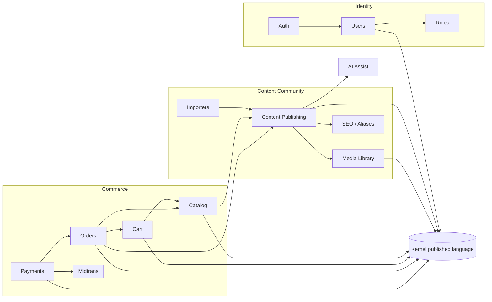

# Domain Model — Contexts and Layers

> **Audience.** Developers and AI agents changing a domain package, a module
> boundary, or a commerce flow. This doc is the map of Lesstruct's DDD
> adoption: which bounded contexts exist, how they relate, and which layer
> owns what.
>
> Companions: [ubiquitous-language.md](ubiquitous-language.md) for the
> vocabulary, [orders-bounded-context.md](orders-bounded-context.md) for the
> deep commerce example, and the repo-only PlantUML sources
> `context-map.puml` / `class-diagram.puml` (the docs site renders the
> Mermaid summary below instead).

## How DDD is applied

Lesstruct is modular by construction: a first-party feature is a Go module
under `modules/<name>/`, and the module is the compile-time unit a context
is deployed as. Most contexts are exactly one module (catalog, cart,
orders, payments, media, users, auth, textgen); Content Publishing is one
context split across cooperating modules (`content`, `posttypes-basic`,
`comments`, `seo`, `importers`) because each carries its own lifecycle and
schema. The model inside a domain package is ordinary Go — structs with
behaviour, sentinel errors, and narrow interfaces — not a framework.

The layer grammar is fixed:

| Layer | Location | Owns | Must not |
|---|---|---|---|
| Domain | `modules/<name>/domain/` (or `internal/domain/<name>/`) | Entities, value objects, enums, invariant checks, sentinel errors, repository and provider **ports**, the domain service (use cases) | Import HTTP, SQL drivers, or remote provider clients; cross-context calls go through `kernel/` published language or a declared port (the root `content` context's embedded `seo` dependency is the one supporting-module exception) |
| HTTP adapter | `modules/<name>/api/` | Request decoding, identity from context, envelope writing, error mapping | Contain business rules that the service can enforce |
| Persistence adapter | `modules/<name>/store/` | SQL for the domain's repository port, per-driver dialect handling | Leak `database/sql` types into the domain |
| Provider adapter | `modules/<name>/infrastructure/` | External clients that implement a domain port (AI text and image generation) | Be imported by the domain |
| Driver package | `modules/<name>/<driver>/` | A self-contained transport driver with its own protocol (e.g. `payments/midtrans`) | Import the module's store or HTTP layer |
| Composition adapter | `internal/editions/<name>/` | Anti-corruption layers wiring one context's service onto another context's port | Be imported by any module |
| Published language | `kernel/` | Shared contracts and pure helpers: `content`, `customfield`, `capability`, `database`, `storage`, `seo`, `sanitize`, `tiptap`, `i18n`, `posttype`, `legal`, `httpx` | Depend on `internal/` or any module |

**The domain `Service` is the application layer.** There is deliberately no
separate `application/` package. A service method is one use case: it
validates input, loads the aggregate through a port, enforces the invariant,
writes through a port, and performs best-effort side effects. This keeps the
module small and makes the transaction boundary explicit in the store
implementation. Consumers that need more orchestration put it in an edition
adapter, where cross-context wiring belongs.

### Why these trade-offs

- **No domain events.** Module boundaries are compile-time seams, and the
  authoritative writes are single-row conditional statements. Cross-context
  effects (stock release, email, plugin hooks) are inline and ordered around
  those writes, so the code shows the race semantics instead of hiding them
  behind a bus. See `ConfirmPaid` in
  [orders-bounded-context.md](orders-bounded-context.md#concurrency-and-race-safety).
- **No generic repository.** Each context declares only the methods its use
  cases need. A store can satisfy several ports structurally, but no shared
  `Repository[T]` abstraction exists to leak storage assumptions into the
  model.
- **No ORM or identity map.** Stores are hand-written SQL over
  `database/sql`; entities are loaded per call. Conditional updates
  (`UPDATE … WHERE stock + ? >= 0`, `MarkPaid`) are the concurrency primitive.
- **Integer minor units, not floats.** Money is stored as `int64` in every
  table and on the wire. The orders context wraps it in the `Money` value
  object when a document must render an amount with its currency
  ([Money](#money)). Catalog and cart carry bare integers because the
  platform adopts one currency at startup and attaches it at the presentation
  boundary; orders is where a stored order can outlive a currency change, so
  it carries the currency with every amount.
- **Primitive request inputs.** Service methods accept small request structs
  or primitives rather than command objects. Validation still belongs to the
  service, so the HTTP layer cannot bypass it.
- **Known library coupling.** A few domains import low-level libraries that
  implement the computation rather than an adapter: `media` (and
  `profilepicture`) use image codecs, and `posttypes-basic` parses TOML field
  schemas. These are computation libraries, not remote-system adapters; the
  plugin runtime handle lives in `internal/plugin/loader`, AI clients in
  `modules/<name>/infrastructure/`, and the payment gateway in
  `modules/payments/midtrans` — all outside the domain.

## Bounded contexts

| Context | Packages | Classification | Responsibility |
|---|---|---|---|
| **Content Publishing** | `internal/domain/content`, `modules/posttypes-basic`, `modules/comments`, `modules/seo`, `modules/importers/{wordpress,hugo}`, `internal/content/{tiptap,markdown,export,ssg}` | Core | The publishing model: content items, post types, custom/system fields, translations, comments, aliases, SEO derivation, imports and export. |
| **Catalog** | `modules/catalog` | Core (commerce) | Commerce data attached to a content item: price, sale price, SKU, variant matrix, tracked stock, low-stock notices. |
| **Cart** | `modules/cart` | Supporting (commerce) | Guest-first, token-keyed carts with live catalog pricing. Never stores prices. |
| **Orders** | `modules/orders` (+ `modules/orders/pdf`) | Core (commerce) | Checkout snapshotting, the order lifecycle, stock reservation/release, guest tracking, shipping, invoices. |
| **Payments** | `modules/payments` (+ `modules/payments/midtrans`) | Supporting (commerce) | Manual transfer proofs, verification decisions, hosted-checkout sessions, gateway webhooks. |
| **Identity & Access** | `modules/users`, `modules/auth`, `internal/domain/role`, `internal/domain/apikey`, `internal/identity` | Supporting | Users, credentials, MFA, registration and verification, roles/capabilities, API keys, the `Principal` bridge. |
| **Media Library** | `modules/media` (+ `domain/thumbnail`) | Supporting | Upload, WebP conversion, thumbnails, dedup, perceptual hashes, AI image generation. |
| **AI Assist** | `modules/textgen` | Supporting | Enhance/translate content and generate HTML through a provider port. |
| **Platform** | `internal/domain/plugin`, `internal/domain/dashboard`, `internal/storage`, `internal/repository`, `internal/config`, `internal/email` | Generic | WASM plugin runtime, dashboard reporting, storage backends, database drivers, configuration, email delivery. |
| **Presentation** | `modules/site-ssr`, `modules/theme-default`, `modules/theme-storefront`, `web/admin/`, `cmd/lesstruct-cli/` | — (consumer) | HTTP/HTML/CLI surfaces over the contexts above. Not a domain; owns no business invariants. |

`internal/domain/apikey`, `content`, `dashboard`, `plugin`, and `role` are the
five contexts whose code still lives in the root module. Everything else is
an extracted Go module. New first-party features go to `modules/<name>/`
(see [project-context.md](../project-context.md#where-does-new-code-go)).

## Context map



Relationship patterns, in DDD terms:

| Upstream → downstream | Pattern | Contract |
|---|---|---|
| Catalog → Cart | Customer/Supplier | Cart defines `CatalogSource.ResolveLine`; the commerce edition adapts `catalog.Service` onto it and wraps unknown lookups in cart sentinels. |
| Cart → Orders | Customer/Supplier | Orders defines `CartSource` (`Snapshot` + `Consume`). The atomic `Consume` is the checkout claim. |
| Content → Orders | Published Language + ACL | Orders defines `ContentSource.ProductTitle`; the edition adapts `content.Service.GetPublishedByID` and falls back to a generic title. Only a content ID crosses the boundary. |
| Catalog → Orders | Customer/Supplier + ACL | Orders defines `Inventory.Reserve`/`Release`; the edition adapts the catalog's conditional `AdjustStock` and translates sentinels. |
| Orders → Payments | Customer/Supplier | Payments defines a narrow `Orders` seam (`OrderRef`, `Confirm`, `Refund`); the edition adapts the live orders service. Payments never imports `modules/orders/domain`. |
| Payments → Midtrans | Anti-Corruption Layer | `modules/payments/midtrans` translates Snap sessions, checksums, and notification vocabulary into `GatewaySession`/`Notification`. |
| Content → SEO | Supporting-module dependency | The content service consumes `modules/seo/domain` for publish-time metadata; pure URL/HTML helpers live in `kernel/seo`. |
| Content → Media | Published language | Only URLs and IDs cross; media is resolved by the presentation layer, never imported by content. |
| All contexts → Kernel | Shared kernel | Frozen semver contracts (`kernel/vX.Y.Z`); see [kernel-versioning.md](../kernel-versioning.md). |
| Plugins → Content | Port/adapter | The content domain exposes `HookExecutor`; `internal/domain/plugin` implements it. |

The commerce chain is a **Requires** chain: `cart` requires `catalog`,
`orders` requires `cart`, `payments` requires `orders`. Disabling an upstream
module cascades its dependents off the registry, so a half-wired commerce
binary cannot boot.

## Aggregates and value objects

| Aggregate | Root | Entities | Value objects / enums | Invariants |
|---|---|---|---|---|
| Content item | `contentdomain.Content` | translations (via group ID), custom fields | `Status`, `Format`, slug rules | title/body format validity, per-language slug uniqueness, immutable published slug, translation-group existence, system-field ownership |
| Product | `catalog.Product` | `Variant` | `Options` (axes), `EffectivePrice`, `InStock`, `LowStock` | non-negative prices, sale ≤ price, axis shape, variant axis-match, unique variant SKUs, `MaxVariants` |
| Cart | `cart.Cart` (read model over `StoredCart`) | `CartLine` | token, quantity range, `Available` | quantities 1–99, token hashed at rest, prices live, unavailable lines excluded from totals |
| Order | `orders.Order` | `OrderItem` | `Money`, `Address`, `Status`, `customerEmail`, `customerName` | an order only comes from a claimed cart, snapshots are immutable, paid only through `ConfirmPaid`, terminal states closed |
| Payment | `payments.Payment` | — | `Method`, `Status`, `OrderRef` | append-only history, pending-only decisions, amount snapshot, verification delegates the paid flip to the order lifecycle |
| Media file | `media.Media` | `MediaVariant` | hash, thumbnail spec | supported signature, pixel budget, dedup, cleanup on partial save |
| User | `users.User` | — | role, capabilities | unique email/username, verified-before-login policy, admin-approval policy |

### Money

`orders.Money` is the only currency-bearing value object:

```go
type Money struct {
    Amount   int64  // minor units, never a float
    Currency string // ISO 4217-ish code adopted from [catalog] currency
}
```

- `NewMoney(amount, currency)` pairs the ledger integer with its code.
- `Format()` renders `IDR 598,000` for zero-decimal currencies (IDR, JPY,
  KRW, VND) and `USD 59.80` for the rest. Negative amounts render with a
  leading `-`.
- Persistence and wire shapes stay integers (`subtotal`, `shippingMinor`,
  `unitPrice`, …). `Money` exists so a render path cannot pair one order's
  amount with another currency by accident.
- Tax is display-only. `BuildInvoice` computes `Tax = Total × rate / 100`
  for the PDF breakdown; the order total remains the money truth and is
  never rewritten by an invoice read.

## Domain services and ports

A typical domain package declares its ports beside its model:

| Port | Context | Adapter |
|---|---|---|
| `Repository`, `PostTypeServiceInterface`, `HookExecutor`, `AliasDeleter` | Content | SQL repositories, `posttypes-basic`, plugin runtime, seo alias store |
| `ProductStore`, `Mailer` | Catalog | catalog store, edition mailer |
| `CartStore`, `CatalogSource` | Cart | cart store, edition adapter over catalog |
| `OrderStore`, `CartSource`, `ContentSource`, `Inventory`, `Mailer`, `InvoiceRenderer` | Orders | orders store, cart service, content service, catalog `AdjustStock`, email service, maroto PDF renderer |
| `Orders` (seam), `Gateway` | Payments | edition adapter over orders, `payments/midtrans` |
| `Repository`, `Storage`, `ImageGenerationService` | Media | media store, `internal/storage`, `media/infrastructure` |
| `TextGenerationService` | AI Assist | `textgen/infrastructure` (OpenAI-compatible) |

Best-effort side effects are explicit: `_ = s.mail.Send…`, `_ =
s.inventory.Release…`. The authoritative write already happened, so the
domain reports the original failure rather than a cleanup or delivery miss.

## Testing the model

- Every `domain/` package carries a **100% statement-coverage** bar: the
  root runs `go test -cover ./internal/domain/...`, and each extracted Go
  module runs `go test -cover ./domain/...` from its own directory. See
  [module-development.md](../module-development.md).
- Tests live in `<package>_test` and are table-driven (`tt` loop variable,
  `name` first, `wantErr` where errors return). They exercise public
  behaviour only.
- Mocks are generated with `make mock` (mockery + testify); narrow seams
  sometimes use hand-written recording stubs for clarity. Test-only seams
  (clock, entropy) are package variables swapped through `export_test.go`
  helpers and restored with `t.Cleanup`.
