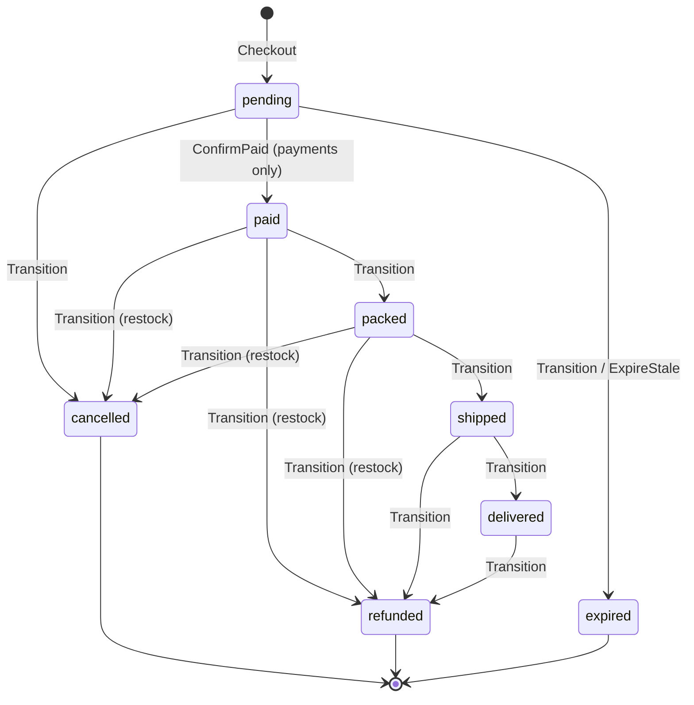

# Orders — Bounded Context Deep Dive

> **Audience.** Developers changing checkout, the order lifecycle, stock
> settlement, tracking, shipping, or invoices. This is the reference model
> for the richest commerce context and the template for how a Lesstruct
> domain package is shaped.
>
> Context map and layer rules: [domain-context.md](domain-context.md).
> Vocabulary: [ubiquitous-language.md](ubiquitous-language.md). Source:
> `modules/orders/domain/` (`order.go`, `status.go`, `money.go`,
> `invoice.go`, `service.go`).

## Position in the map

```
Cart ──Snapshot/Consume──▶ Orders ◀──Inventory── Catalog
                              │
                              ├──ContentSource──▶ Content
                              ├──Mailer─────────▶ Email
                              └──InvoiceRenderer▶ modules/orders/pdf

Payments ──Details/Confirm/Refund──▶ Orders
```

Orders is downstream of Cart, Content, and Catalog, and upstream of
Payments. It **never imports** `modules/cart`, `modules/catalog`, or
`internal/domain/content`; the commerce edition supplies anti-corruption
adapters. The aggregate is persisted by `modules/orders/store` (single SQL
implementation over `kernel.Dialect`), and rendered by `modules/orders/pdf`
(maroto behind the `InvoiceRenderer` port).

## Aggregate model

### Order (aggregate root)

```go
type Order struct {
    ID            int64
    Status        Status
    Items         []OrderItem   // loaded on detail reads; nil on lists
    CustomerEmail string        // canonical, lowercased, validated
    CustomerName  string        // trimmed, required
    CustomerPhone string        // trimmed, optional
    ShipTo        Address
    Currency      string        // adopted from the platform config
    Subtotal      int64         // frozen item total, minor units
    ShippingMinor int64         // admin-set, pending only
    Consent       *legal.Consent // GDPR evidence when the gate was active
    CreatedAt     time.Time
    UpdatedAt     time.Time
}
```

Behaviour lives on the aggregate:

- `DisplayNumber()` derives `ORD-000042` from the row ID. Numbers are never
  stored, so there is nothing to keep in sync.
- `TotalMinor()` is `Subtotal + ShippingMinor`. Shipping is stored once;
  no derived total column can drift.
- `Consent` records the checkout affirmation: `AcceptedAt` plus the exact
  terms/privacy revisions (`PageID`, `Slug`, `Language`, `UpdatedAt`). The
  `ConsentPolicy` value object carries the boot-time resolution's required
  flag and documents into `Checkout`; a required policy without an
  affirmative `consentAccepted` refuses with `ErrConsentRequired`. A store
  without the gate stores nil, so the wire shape is unchanged.

### OrderItem (entity, immutable snapshot)

```go
type OrderItem struct {
    ID               int64
    OrderID          int64
    ProductContentID int
    VariantID        *int64
    SKU              string
    Title            string
    UnitPrice        int64
    Quantity         int
}

func (i *OrderItem) LineTotal() int64
```

SKU, title, and unit price freeze at checkout. Later product edits, price
changes, or deletions cannot rewrite order history. Only the unit price is
stored; the extended total is derived. `VariantID` is nullable because a
product-level line has no variant.

### Value objects

| Value object | Definition | Rule |
|---|---|---|
| `Money` | `{Amount int64, Currency string}` | Minor units; `Format()` is the one rendering rule |
| `Address` | street, city, province, postal code | all four required after trimming |
| `customerEmail` | private string type | lowercased + `mail.ParseAddress` at checkout; tracking only canonicalises, never validates |
| `customerName` | private string type | trimmed and non-empty |
| `Status` | string enum | exactly the eight lifecycle states |
| Order number | `ORD-` + zero-padded ID | parsed case-sensitively; ID must be positive |

Money is created through `NewMoney` and never mixed across currencies in a
document. See [domain-context.md#money](domain-context.md#money) for the
zero-decimal rendering table.

### Lifecycle



`CanTransition(from, to)` is the single authority, backed by the `lifecycle`
map. Terminal states are absent from the map, so nothing leaves them.
`paid` is intentionally not an admin transition target: the only door into
it is `ConfirmPaid`, the payment-gated settlement path.

## Invariants

1. **An order starts as a claimed cart.** `Checkout` calls
   `CartSource.Snapshot`, validates every line, then `CartSource.Consume`
   *before* storing the order. A cart cannot produce two orders.
2. **Empty carts cannot become orders.** `ErrEmptyCart`.
3. **Only sellable lines are snapshotted.** A line whose product/variant is
   unavailable aborts with `ErrLineUnavailable`; an out-of-stock line aborts
   with `ErrOutOfStock`. Stock is validated at checkout and decremented at
   payment.
4. **Snapshots are immutable.** Title/SKU/unit price are copied; nothing
   re-reads the catalog to render an existing order.
5. **Currency is platform-owned.** The client never sends a currency;
   `NewService(..., currency)` stamps it into the order.
6. **Totals are derived.** `TotalMinor = Subtotal + ShippingMinor`; no
   stored total exists.
7. **Shipping is pending-only and non-negative.** `SetShipping` rejects
   `amount < 0` (`ErrInvalidShipping`) and non-pending orders
   (`ErrInvalidTransition`); the store's conditional update loses a race
   against a concurrent status flip.
8. **`paid` is payment-gated.** `Transition` refuses a `paid` target;
   `ConfirmPaid` is the only path.
9. **Stock moves exactly once.** `Reserve` precedes the conditional
   `MarkPaid`; a storage failure or a lost flip releases the reservation.
   An already-paid order is returned as-is, so webhook retries cannot
   double-decrement.
10. **Fulfilment unwind restocks once.** Cancelling or refunding from
    `paid`/`packed` releases the reserved quantities. `shipped`/`delivered`
    do not reclaim goods from the catalog.
11. **Terminal states are closed.** Cancelled, refunded, and expired have no
    outgoing transitions.
12. **Tracking never enumerates — and never trusts a guessable key.** A
    malformed number, unknown order, wrong email, missing token, and
    mismatched token all read `ErrOrderNotFound`. The guest gate is
    three-factor: order number, canonical email, and a 128-bit per-order
    tracking token minted at checkout (raw token delivered once — checkout
    response + confirmation email — hash-only at rest). Sequential numbers
    and knowable emails alone open nothing; orders from before the token
    existed carry an empty hash and are untrackable through the guest gate.
13. **Email is best-effort.** Confirmation, status, and expiry notices are
    discarded on failure; the order row is authoritative.
14. **Invoice reads never mutate money.** `BuildInvoice` derives tax and
    totals on demand; nothing is persisted.
15. **Consent is evidence, not a setting.** When the gate is active, a
    checkout without an affirmative acceptance refuses before the cart is
    claimed, and a successful order stores the accepted revision — page ID
    plus last-updated timestamp, with slug and language for readability.
    Later edits to the legal page never rewrite the recorded evidence.

## Use cases

| Use case | Input | Reads | Writes / effects | Refuses |
|---|---|---|---|---|
| `Checkout` | `CheckoutInput` (token, email, name, phone, address, `consentAccepted`) | cart snapshot, product titles, consent policy | consumes cart, creates pending order (with consent evidence + tracking token hash), confirmation email with the raw tracking link | invalid email/name/address, gone/empty cart, unavailable/out-of-stock line, missing acceptance when required |
| `Tracking` | order number + email + tracking token | order by derived ID + canonical email + token hash | — | every mismatch (including a missing token) → `ErrOrderNotFound` |
| `Get` | ID | order + items | — | `id <= 0`, `ErrOrderNotFound` |
| `List` | optional status, cursor, limit | newest-first summaries | — | invalid status; limit clamps to 1–100, default 50 |
| `Transition` | ID, target status | order | conditional `SetStatus`, possible stock release, status email | unknown status, `paid` target, illegal move |
| `SetShipping` | ID, amount | order | conditional `SetShipping` | negative amount, non-pending order |
| `ConfirmPaid` | ID | order | `Reserve`, conditional `MarkPaid`, release on loss, status email | illegal status, `ErrInsufficientStock`, reserve/store failures |
| `ExpireStale` | cutoff, limit | pending IDs | conditional expiry, best-effort emails | store failure |
| `BuildInvoice` | ID, `InvoiceSettings` | order | none (derived document) | unknown order |

`Checkout` input is validated before any cart read, so malformed contact
data never consumes a cart. The order is stored only after the claim; a
storage failure abandons the cart and the customer rebuilds it — an
accepted cost, because duplicate money records are worse than a
re-buildable cart.

## Ports

| Port | Methods | Adapter |
|---|---|---|
| `OrderStore` | `CreateOrder`, `FindByID`, `FindByNumberAndEmail`, `List`, `SetStatus`, `SetShipping`, `MarkPaid`, `ExpirePending` | `modules/orders/store` |
| `CartSource` | `Snapshot`, `Consume` | edition adapter over `modules/cart` |
| `ContentSource` | `ProductTitle` | edition adapter over `internal/domain/content` |
| `Inventory` | `Reserve`, `Release` | edition adapter over `catalog.AdjustStock` |
| `Mailer` | `SendOrderConfirmationEmail`, `SendOrderStatusEmail` | edition adapter over `internal/email` |
| `InvoiceRenderer` | `Render` | `modules/orders/pdf` |

`OrderStore.MarkPaid` and `SetShipping` return `(bool, error)`: the boolean
reports whether the conditional statement changed a row. That is the
domain's race signal, not an implementation detail.

## Concurrency and race safety

Checkout has no distributed transaction. It uses an ordered claim:

1. `Snapshot` prices the presented token.
2. `Consume` deletes the cart atomically.
3. Only after a successful delete does `CreateOrder` run.

Parallel checkouts on one token race step 2; the loser sees `ErrCartGone`.
A crash between 2 and 3 loses the cart but never duplicates an order.

Payment settlement uses a claim + compensation:

1. `Reserve` decrements stock conditionally (never below zero).
2. `MarkPaid` flips `pending → paid` only if still pending.
3. If the flip loses the race or storage fails, `Release` returns the
   reserved quantities; the authoritative row wins.
4. If the order is already `paid`, the call returns it without touching
   stock, making webhook retries idempotent.

The expiry sweep and payment confirmation can race on the same pending
order. `MarkPaid` and `ExpirePending` are both conditional writes; exactly
one wins, and the loser unwinds or re-reads. `Transition` and `SetShipping`
have the same property at the statement level.

## Invoice derivation

`BuildInvoice` loads the order (items included), then derives:

- `Number`: `INV-` + zero-padded order ID, in step with `ORD-000042`.
- `IssuedAt`: `time.Now().UTC()` at render time.
- Lines: frozen title/SKU/quantity, `UnitPrice` and `LineTotal` as `Money`.
- `Subtotal`, `Shipping`, `Total`: `Money` values from the frozen order.
- `TaxRate`: percent from the live `[invoice]` settings; negative rates
  clamp to 0.
- `Tax`: `round(Total × rate / 100)` as a **display-only** breakdown.

Nothing is persisted, so re-rendering always reflects the current order
record, and the tax line can never rewrite the amount actually charged.
The PDF renderer is swappable behind `InvoiceRenderer`.

Invoice settings are module state, not domain state: the module holds the
adopted block behind an `RWMutex` (`InvoiceSettings` / `SetInvoiceSettings`)
so an admin edit applies to the next render without a restart. The write
path persists first through `WithInvoiceSettingsSaver` (the composition
root's `config.SaveInvoice`, an atomic read-modify-write of the `[invoice]`
table); a failed write leaves the running settings untouched. The API
surface (`GET/PUT /api/v1/orders/invoice-settings`) validates the rate
(0–100, explicit zero preserved) before the module sees it.

## PII encryption at rest

Customer PII (email, name, phone, shipping snapshot) is encrypted with
AES-256-GCM at the store boundary (`modules/orders/store`) through the
shared `kernel/pii` primitive — never in the domain, which stays plaintext
pure. The `v1:` envelope doubles as the backfill detector and the future
rotation marker; legacy rows without the prefix decrypt through untouched,
and empty fields stay empty. Randomized ciphertext cannot be queried, so
guest tracking resolves through the deterministic HMAC blind-index column
`customer_email_idx` (computed over the already-normalized email the
service passes). The commerce edition provisions the cipher from
`PII_MASTER_KEY` (base64, 32 bytes; missing or invalid fails startup
closed) and backfills legacy rows in batches after module migrations; a
corrupt envelope surfaces as a store error, never silent wrong data. The
payments side mirrors this for reference and verifier identity
(`reference_idx`). `EncryptPending` is a concrete maintenance method on each
store (not part of the domain `OrderStore`/`PaymentsStore` ports) that the
startup sweep calls in batches. No card data is ever stored.

## Error catalog

| Sentinel | Meaning | Typical surface |
|---|---|---|
| `ErrOrderNotFound` | unknown order, bad number, or tracking mismatch | public tracking 404 |
| `ErrInvalidTransition` | lifecycle forbids the move | admin 409 |
| `ErrInvalidStatus` | unknown status value | admin 400 |
| `ErrInvalidEmail` | malformed checkout email | checkout 400 |
| `ErrInvalidName` | empty checkout name | checkout 400 |
| `ErrInvalidAddress` | incomplete shipping address | checkout 400 |
| `ErrInvalidShipping` | negative shipping amount | admin 400 |
| `ErrEmptyCart` | snapshot has no lines | checkout 409 |
| `ErrCartGone` | unknown, malformed, or already-consumed cart token | checkout 409 |
| `ErrOutOfStock` | a line is out of stock at checkout | checkout 409 |
| `ErrLineUnavailable` | a line no longer resolves to a sellable product/variant | checkout 409 |
| `ErrInsufficientStock` | payment cannot cover the sold quantities | payments 409 `OUT_OF_STOCK`; the order stays pending |

Handlers map these to the realm envelope; the domain never writes HTTP.

## Testing contract

- `modules/orders/domain` is at **100% statement coverage**. Every public
  use case has a table-driven suite; happy paths and each refusal branch are
  rows.
- Seams are testify mocks (`make mock`) except where a tiny hand-written
  stub makes the intent clearer. The mailer is asserted for best-effort
  semantics, not just for calls.
- Concurrency is tested through the port contracts: `MarkPaid`/`SetShipping`
  `false` results, `MarkPaid` errors after `Reserve`, already-paid early
  return, and `ExpireStale` read misses.
- The PDF renderer has its own suite in `modules/orders/pdf`; the domain
  suite treats it as a fake renderer.
- When adding a use case: add the port method, the store implementation for
  all three drivers, the edition adapter, the handler, the Bruno request,
  and a domain table row — in that order.
